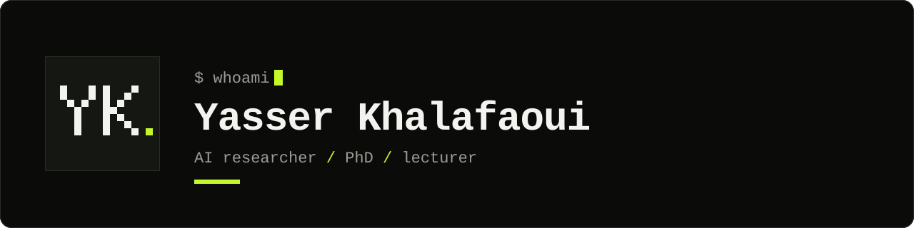

<picture>
  <source media="(prefers-color-scheme: dark)" srcset="assets/header-dark.svg">
  <source media="(prefers-color-scheme: light)" srcset="assets/header-light.svg">
  
</picture>

I research and build AI systems: LLM evaluation, conversational agents, multi-agent orchestration, and making models safer and more reliable.

### Activity

<picture>
  <source media="(prefers-color-scheme: dark)" srcset="https://raw.githubusercontent.com/MKDYasserH/MKDYasserH/output/stats-dark.svg">
  <source media="(prefers-color-scheme: light)" srcset="https://raw.githubusercontent.com/MKDYasserH/MKDYasserH/output/stats-light.svg">
  
</picture>

<picture>
  <source media="(prefers-color-scheme: dark)" srcset="https://raw.githubusercontent.com/MKDYasserH/MKDYasserH/output/snake-dark.svg">
  <source media="(prefers-color-scheme: light)" srcset="https://raw.githubusercontent.com/MKDYasserH/MKDYasserH/output/snake-light.svg">
  
</picture>

### Toolbox

       
    
     

### Get in touch

Happy to talk about LLM evaluation, conversational agents, or a research collaboration: [LinkedIn](https://www.linkedin.com/in/yasser-khalafaoui) · [X](https://x.com/YasserMoui)
